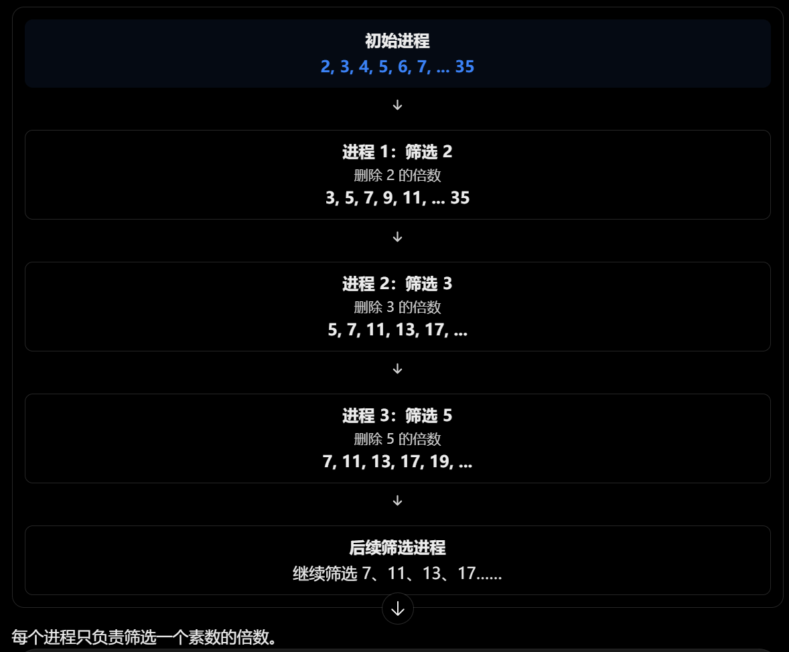

## xv-6 book Primes_Lab 题解
### 实验题目翻译
>这道题的核心任务是：使用管道（pipes）实现并发素数筛选器（concurrent prime sieve）。
1. 实验目标
使用 xv6 中的管道和进程，实现一个并发的素数筛选程序。程序通过多个进程组成一条管道流水线，每个进程负责筛选一个素数的倍数。

2. 实验要求
- 将程序编写在 user/primes.c 中。

- 使用 pipe() 创建管道，使用 fork() 创建进程。

- 第一个进程将整数 2～35 写入管道。

- 每个筛选进程从左侧管道读取整数，并将不能被当前素数整除的整数写入右侧管道。

- 每个进程读取到的第一个整数就是当前阶段的素数。

- 每发现一个素数，就创建一个新的进程和管道，继续进行下一轮筛选。

- 每个进程都需要关闭不再使用的文件描述符。

- 第一个进程需要等待整个流水线结束，包括它的子进程、孙进程等后代进程。

- 当管道的所有写端关闭，并且管道中没有剩余数据时，read() 返回 0，表示 EOF。

- 直接使用 32 位整数（4 字节）在管道中传输数据。

- 按照需要创建进程，避免创建不必要的进程。

- 将程序加入 UPROGS，使其能够在 xv6 中运行。

3. 预期输出
```
prime 2
prime 3
prime 5
prime 7
prime 11
prime 13
prime 17
prime 19
prime 23
prime 29
prime 31
```

### 程序整体工作原理
>方法：Sieve of Eratosthenes（埃拉托斯特尼筛法）

>基本过程是：
1. 第一个进程接收 2～35。
2. 读取第一个数字 2，确定当前筛选素数为 2。
3. 把不能被 2 整除的数字传给下一个进程。
4. 下一个进程读取第一个数字 3，确定当前筛选素数为 3。
5. 把不能被 3 整除的数字传给下一个进程。
6. 不断重复，直到没有数字可以继续筛选。
2. 流水线示意图



>每个进程只负责筛选一个素数的倍数。

### 代码分析以及思路
>这是一开始的版本
```c
#include "kernel/types.h"
#include "kernel/stat.h"
#include "user/user.h"

void sieve(int left_pipe[])
{
    int p;
    if(read(left_pipe[0],&p,sizeof(int))==0)
    {
        close(left_pipe[0]);
        return ;
    }

    printf("prime %d\n",p);
    
    int right_pipe[2];
    
    pipe(right_pipe);
    if(fork()==0)
    {
        close(right_pipe[1]);
        close(left_pipe[0]);
        sieve(right_pipe);
    }

    else
    {
        int n;
        close(right_pipe[0]);
        while(read(left_pipe[0],&n,sizeof(int))==sizeof(int))
        {
            if(n%p!=0)
            {
                write(right_pipe[1],&n,sizeof(int));
                
            }
        }
        close(left_pipe[0]);
        close(right_pipe[1]);
        wait(0);
    }
}


int main()
{
    int initial_pipe[2];
    pipe(initial_pipe);

    if(fork()==0)
    {
        close(initial_pipe[1]);
        sieve(initial_pipe);
        exit(0);
    }

    else
    {
        close(initial_pipe[0]);
        for(int i=2;i<=35;i++)
        {
            write(initial_pipe[1],&i,sizeof(int));

        }
        close(initial_pipe[1]);
        wait(0);
    }

    exit(0);

}
```

>这是后来的版本
```c
#include "kernel/types.h"
#include "kernel/stat.h"
#include "user/user.h"

int sieve(int left_pipe[])
{
    int p;
    int ret = read(left_pipe[0], &p, sizeof(int));

    if(ret == 0)
    {
        close(left_pipe[0]);
        return 0;
    }

    if(ret != sizeof(int))
    {
        printf("read failed\n");
        close(left_pipe[0]);
        return -1;
    }

    printf("prime %d\n",p);

    int right_pipe[2];
    
    if(pipe(right_pipe)<0)
    {
        printf("pipe failed");
        close(left_pipe[0]);
        return -1;
    }

    int pid=fork();
    if(pid<0)
    {
        printf("fork failed");
        close(right_pipe[0]);
        close(right_pipe[1]);
        close(left_pipe[0]);
        return -1;
    }
    
    
    else if(pid==0)
    {
        
        close(right_pipe[1]);
        close(left_pipe[0]);
        int result=sieve(right_pipe);
        exit(result==0?0:1);
        
    }

    else
    {
        close(right_pipe[0]);
        int n;
        int error=0;

        while(1)
        {
            ret=read(left_pipe[0],&n,sizeof(int));
            if(ret==0)
            break;

            if(ret!=sizeof(int))
            {
                printf("read failed\n");
                error = 1;
                break;
            }
            
            if(n%p!=0)
            {
                if(write(right_pipe[1],&n,sizeof(int))!=sizeof(int))
                {
                    printf("write failed\n");
                    error = 1;
                    break;
                }
                
            }
        
        }
        close(right_pipe[1]);
        close(left_pipe[0]);
    
    
    int status;

    if(wait(&status) < 0)
    {
        printf("wait failed\n");
        error = 1;
    }
    else if(status != 0)
    {
        printf("child process failed\n");
        error = 1;
    }

    return error!=0 ? -1 : 0;
    }
}

int main()
{
    int initial_pipe[2];
    
    if(pipe(initial_pipe)<0)
    {
        printf("pipe failed");
        exit(1) ;
    }
    
    int pid=fork();
    if(pid<0)
    {
        printf("fork failed");
        close(initial_pipe[0]);
        close(initial_pipe[1]);
        exit(1) ;
    }
    
    else if(pid==0)
    {
        close(initial_pipe[1]);
        int result=sieve(initial_pipe);
        exit(result==0 ? 0:1);
    }
    
    else
    {
        close(initial_pipe[0]);
        int error=0;
        
        for(int i=2;i<=35;i++)
        {
            if(write(initial_pipe[1], &i, sizeof(int)) != sizeof(int))
            {
                printf("write failed\n");
                error = 1;
                break;
            }
        }
        close(initial_pipe[1]);
        
        int status;

        if(wait(&status) < 0)
        {
            printf("wait failed\n");
            error = 1;
        }
        else if(status != 0)
        {
            printf("sieve process failed\n");
            error = 1;
        }

        exit(error!=0 ? 1 : 0);
    }
    exit (0);

}
```

>实现思路
第一版是我昨天在 AI 提供思路的帮助下一步步实现的初始程序，其实第一版已经大概能体现整个程序素数筛选的过程，不过第一版没有进行可能进行的错误分析，只有骨架。（感觉还是挺有参考价值的一个版本，所以就与第二版一并放在这里了）。而第二版是我今天自己尝试复现的版本，并且加入了可能遇到的错误情况的分析。

- 下面我就来具体分析一下我的实现思路（以第二版为例）
>sieve 函数：
1. 首先，因为要用到递归的算法，所以我把处理素数的代码封装成了函数 sieve 。既然上文提到，每个进程只负责筛选一个素数的倍数（包括它本身），所以函数开头只需要在left_pipe 中读取一个数即可，又因为每一个进程都会把该进程筛选的素数及其倍数过滤掉，所以新的进程读到的数必定还`新的素数`，这里我们用 p 来存这个素数。
2. 因为要检验 read 的返回结果，所以这里要用 `ret=read(left_pipe[0], &p, sizeof(int))` 来保存返回结果，方便后续检验。因此，在这一步之后很自然的写出了 `ret==0` `ret!=sizeof(int)` 这两种不符合的情况，报错后记得 `close(left_pipe[0])` 即可（注意，这里不需要 `close(left_pipe[1]);`）这是因为每次调用函数之前，传入的 `left_pipe` 中 `left_pipe[1]` 已经关闭了，因此这里不需要重复 close。**还有一点值得注意的是两种错误情况的退出码是不一样的**
3. 确认 read 成功之后就可以输出这个读入是素数了（记得加换行符号）。输出完之后就可以创建 `right_pipe[2]` 这个数组为 pipe 创建管道与 fork 创建子进程作准备了。
4. 先检验 pipe 的结果，若创建管道失败，则 ` printf("pipe failed");close(left_pipe[0]);return -1;`。确认 pipe 成功之后，与上文类似，这里要检验 fork 的结果，因此就用一个 `pid` 来存 fork 之后每个进程的 `pid` 码。若 `pid` 小于0，很显然此时 fork 失败了，这里报错的同时一定要记得 close 掉 pipe 产生的 `right_pipe[0] 与 right_pipe[1]` 。否则会导致浪费文件描述符，导致资源耗尽。
5. 接下来就到子进程和父进程的程序了:
   - 子进程：先关掉没有用的文件描述符 `left_pipe[0]` 与 `right_pipe[1]` （为什么关这两个：子进程不再需要在 `left_pipe[0]` 这一读端读取数据而是改为在 `right_pipe[0]` 读取数据；而关闭 `right_pipe[1]` 是因为子进程作为现在的父进程的子进程不需要写入数据，只需要读取数据即可。后续调用 sieve 时子进程会作为孙进程的父进程写入数据给孙进程）。调用完 `sieve` 函数 之后要对返回值进行检验，如果返回0就正常 exit(0)，如果返回非0（出现异常）则 exit(1) 表示错误。
   
   - 父进程：依旧先关掉没有用的文件描述符 `right_pipe[0]`（不需要读）。为了后续输入数据与检验方便，这里定义了 n 与 error（检验错误标志）。用一个 while 循环来实现不断读取新的数据。这里先是判断了 read 是否成功，具体过程与上文类似，不再赘述。（只需要注意 `read ==0` 时证明 left_pipe 已经输入完毕，没有新的数据输入，此时就可以 break 了）。然后对 read 进来的数进行检验，如果该数是之前读入的 p 是整数倍，证明不是素数，直接筛掉；如果不是 p 的整数倍，就可以写入 `right_pipe[1]` 给子进程等后面的进程。当然这里依旧要检验 write 是否成功，因为比较简单，不再赘述。最后就是 close 掉用完的 `right_pipe[1] 与 left_pipe[0]`。函数结束时要补一个 wait 防止父进程在子宿进程结束前提前结束。（wait 也要判断是否成功）。函数最后的返回值看错误标志 error 。
   
   - **值得注意的是，虽然父进程的代码写在子进程的后面，但是两者实际上是同时运行的。所以子进程的 read 写在父进程的 write 前面是没有问题的。如果父进程没有write 新的数据而子进程已经读完了缓冲区中的数据的话，子进程会阻塞等待父进程 write 新的数据。相应的，如果父进程先 write 了数据，那么这些数据会存在缓冲区中等待子进程读取，如果 write 的数据已经占满了缓冲区，父进程也会暂时阻塞等子进程先 read 一部分数据再继续 write**
   
   - **还有一点，子进程是不需要 `close(left_pipe[1])` 的，这是因为子进程会继承父进程的文件描述符状态，而在父进程（该父进程是祖父进程的子进程）在调用 sieve 之前就已经 `close(right_pipe[1]);` 注意，这里的 `right_pipe[1]` 实际上就是传参时的 `left_pipe[1]`（因为传参时写的是 `sieve(right_pipe)`）。总之，子进程与父进程都需要及时关闭没有用的文件描述符，但是也不要重复 close 。**

>主函数：
1. 主函数的实现思路其实与 sieve 函数的主进程类似。需要注意的只有一点：那就是这里的 write 是用了一个 for 函数把2到35所有的数都 write 进去了，这里与 sieve 函数中从 `left_pipe` 中读取略有不同。
2. 最后就是及时关闭不需要用到的文件描述符，并且通过检验对应的错误标志正确地 exit。


>踩过的坑：
- 
| 我的理解 / 错误写法 | 正确理解 | 解释 |
|---|---|---|
| 子进程不需要 `left_pipe`，就不知道 `right_pipe` 的数据从哪里来。 | 父进程向 `right_pipe` 写入，子进程从 `right_pipe` 读取。 | 父子进程通过 `fork()` 继承管道描述符，因此可以访问同一个管道。子进程不需要自己产生数据。 |
| 不关闭管道端只是浪费文件描述符。 | 关闭管道端既是为了释放资源，也是为了保证 EOF 正常出现。 | 只要还有进程持有写端，读端在数据读完后就可能继续阻塞，而不是返回 0。 |
| `fork == 0` 可以判断是否进入子进程。 | 应该使用 `fork() == 0`。 | `fork` 是函数，必须调用它；返回 0 表示当前执行流位于子进程。 |
| 在 `fork()` 之前关闭不需要的管道端。 | 应先 `fork()`，再由父子进程分别关闭不需要的端。 | 子进程会继承父进程已经打开的文件描述符，提前关闭会导致子进程无法使用对应管道端。 |
| 父进程关闭 `right_pipe[1]`，子进程关闭 `right_pipe[0]`。 | 父进程保留写端 `right_pipe[1]`，子进程保留读端 `right_pipe[0]`。 | 父进程负责向下一阶段传递数据，子进程负责读取数据。 |
| `n % p == 0` 时应该把数字写入下一条管道。 | 应使用 `n % p != 0`，并写入 `n`。 | 当前阶段要删除 `p` 的倍数，只把不能被 `p` 整除的数字传给下一阶段。 |
| `write(fd, i, sizeof(int))` 可以写入整数。 | 应使用 `write(fd, &i, sizeof(int))`。 | `write()` 的第二个参数需要内存地址，`&i` 表示整数 `i` 的地址。 |
| `read() != 0` 就表示读取成功。 | 应区分 `read()` 的返回值：正数、0、-1。 | 正数表示读取了相应字节数；0 表示 EOF；-1 表示读取错误。 |
| 只调用 `read()` 和 `write()`，不检查返回值也可以。 | 应检查是否成功读取或写入完整的 `sizeof(int)` 字节。 | 系统调用可能失败，检查返回值才能发现异常。 |
| `main()` 中可以连续调用两次 `pipe(initial_pipe)`。 | 一个初始管道只需要创建一次。 | 重复调用会覆盖原来的描述符，造成资源浪费和管道管理混乱。 |
| 子进程调用 `sieve()` 后直接 `return 0`。 | 应接收 `sieve()` 的返回值，并通过 `exit()` 传递成功或失败状态。 | 否则子进程可能把后续阶段发生的错误误报为成功。 |
| `wait(0)` 和 `wait(&status)` 可以连续调用，分别负责等待和检查状态。 | 只需调用一次 `wait(&status)`。 | 一次成功的 `wait()` 就会回收一个直接子进程；第二次调用可能因没有可等待的子进程而返回 -1。 |
| `wait()` 可以直接等待所有后代进程。 | `wait()` 只能等待当前进程的直接子进程。 | 通过父进程逐级等待子进程，最终可以保证整个进程流水线结束。 |
| `sieve()` 的子进程可以在递归调用返回后再关闭 `left_pipe[0]`。 | 应在递归调用前关闭不再需要的 `left_pipe[0]`。 | 及时关闭无用描述符，避免资源占用，并正确管理管道生命周期。 |